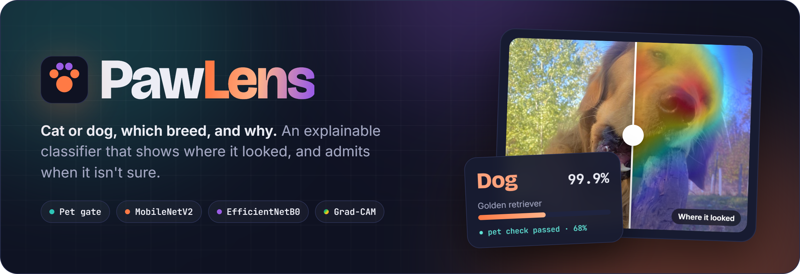
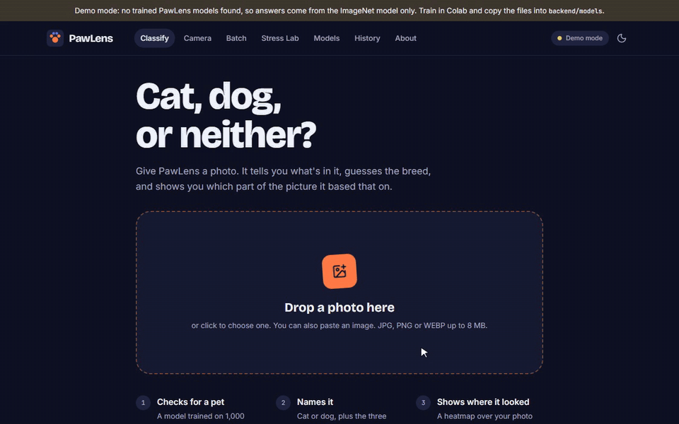
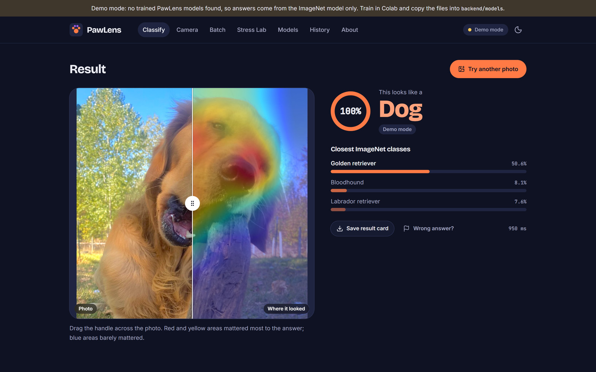
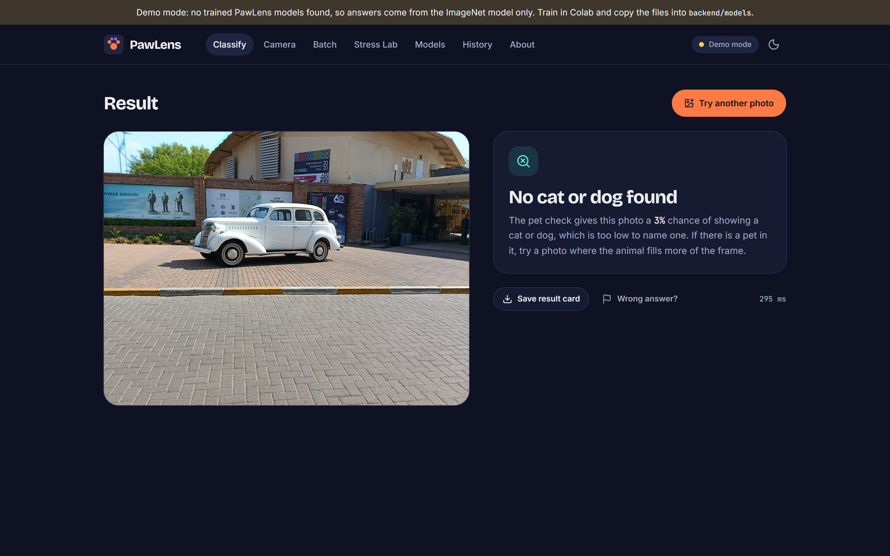
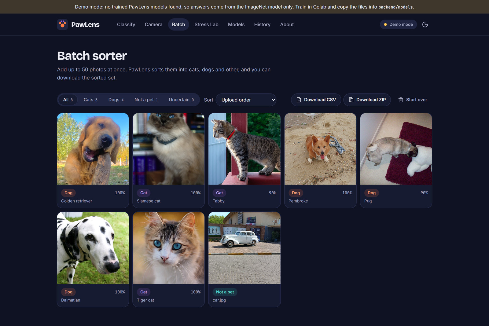
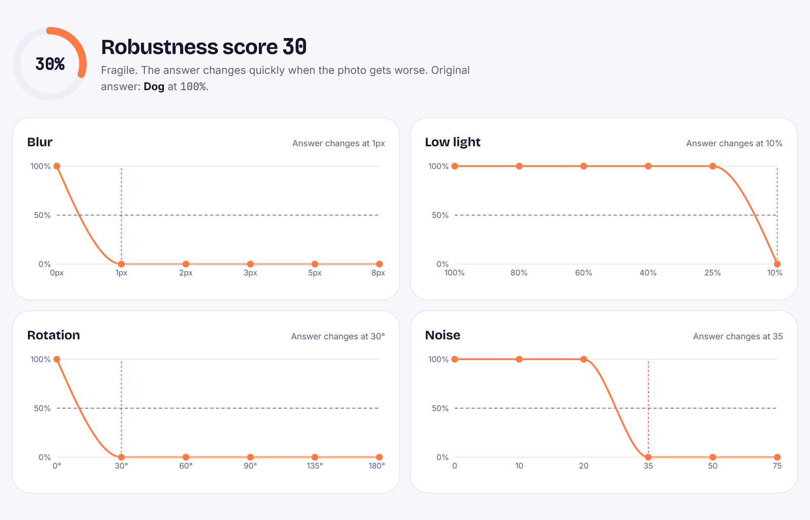
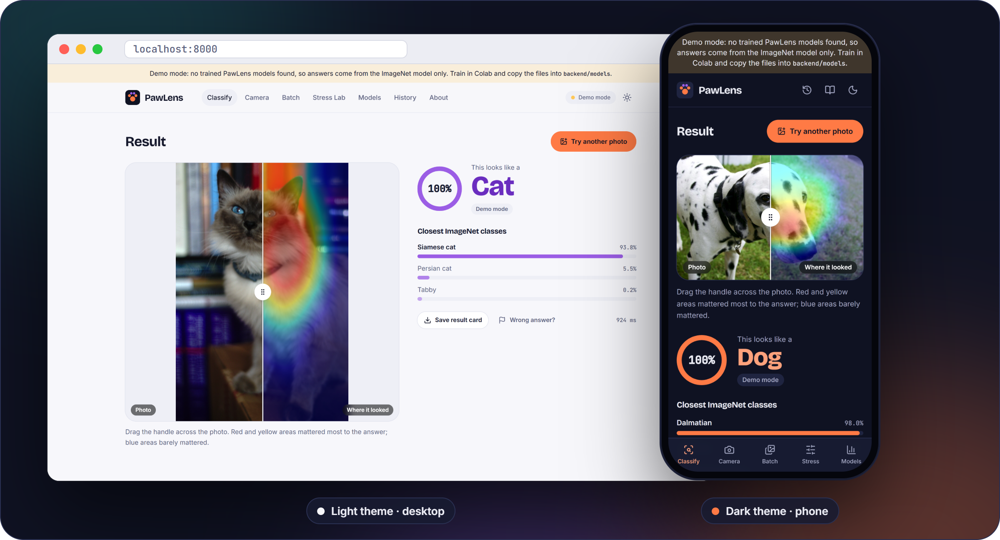
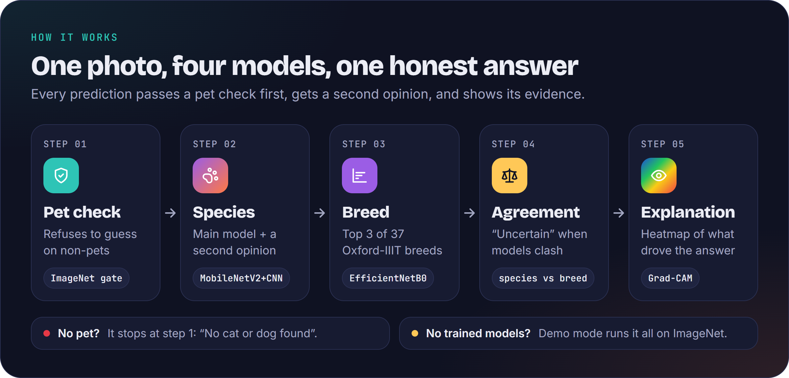

<div align="center">



PawLens checks that a photo actually contains a pet, names the species, ranks 37 breeds,<br>
and draws a Grad-CAM heatmap of where the model looked. When its models disagree, it says so.

<p>
  
  
  
  
  
  
  
</p>

<p>
  <a href="#demo"><b>Demo</b></a> ·
  <a href="#features"><b>Features</b></a> ·
  <a href="#quick-start"><b>Quick start</b></a> ·
  <a href="#how-it-works"><b>How it works</b></a> ·
  <a href="#train-the-models"><b>Training</b></a> ·
  <a href="#api"><b>API</b></a> ·
  <a href="#team"><b>Team</b></a>
</p>

</div>

<br>

## Demo

<div align="center">
  
  <p><sub>
    <a href="docs/assets/demo.mp4"><b>▶ Watch in full quality (MP4)</b></a>
    &nbsp;·&nbsp; Recorded in <b>demo mode</b>: ImageNet weights only, no trained PawLens models. Every prediction on screen is real model output.
  </sub></p>
</div>

<br>

## Features

<table>
  <tr>
    <td width="50%" valign="top">
      
      <h3>Classify, then explain</h3>
      Drop, paste or pick a photo. You get the species with a confidence ring, the top 3 breeds, and a
      <b>drag-to-compare slider</b> between the photo and its Grad-CAM heatmap. Switch which model the heatmap explains.
    </td>
    <td width="50%" valign="top">
      
      <h3>Refuses to guess</h3>
      A pet gate runs first. A car, a sofa or an empty room gets <b>“No cat or dog found”</b>
      with the gate's confidence, never an invented breed.
    </td>
  </tr>
  <tr>
    <td width="50%" valign="top">
      
      <h3>Batch sorter</h3>
      Drop up to <b>50 photos</b>. Filter by cats, dogs, not-a-pet or uncertain, sort by confidence,
      and export a <b>CSV</b> or a <b>ZIP</b> already sorted into <code>cats/</code>, <code>dogs/</code> and <code>other/</code>.
    </td>
    <td width="50%" valign="top">
      
      <h3>Stress test lab</h3>
      How fragile is the prediction? Confidence is charted under <b>blur, low light, rotation and noise</b>,
      the point where the label flips is marked, and everything rolls up into a 0–100 robustness score.
    </td>
  </tr>
  <tr>
    <td colspan="2">
      
      <h3>Light or dark, desktop or phone</h3>
      Follows your system theme with a manual toggle, and switches to a bottom tab bar on phones. The <b>live camera</b> mode
      checks about two frames a second, with a <b>Freeze and explain</b> button for the full answer and heatmap.
      Colour is never the only signal: every badge, chart and heatmap also has a text label.
    </td>
  </tr>
</table>

<details>
<summary><b>And also…</b></summary>
<br>

| | |
|---|---|
| **Model lab** | Accuracy, F1, parameter count and CPU inference time per model, training curves, a confusion matrix, and a Custom CNN vs MobileNetV2 comparison. Read straight from `backend/models/metrics/*.json`; nothing is hard-coded. |
| **Second opinion** | The custom CNN votes alongside MobileNetV2. If the species models disagree, or the top breed belongs to the other species, the result is marked **Uncertain**. |
| **History** | Your last 30 predictions with thumbnails, kept only in your browser. |
| **“Wrong answer?”** | Send the correct label and the photo is saved to `backend/feedback/<label>/` for retraining. Nothing else is ever stored. |
| **Result card** | Download any result as a PNG to share. |

</details>

<br>

## Quick start

> **No training needed.** Without trained models, PawLens runs in **demo mode**: the ImageNet MobileNetV2 handles everything and breed names come from ImageNet's 118 dog and 5 cat classes. A banner says so, and every feature still works.

**You need:** Python **3.10–3.12** and an internet connection on first start (TensorFlow fetches ~14 MB of ImageNet weights once).

```bash
./start.sh        # macOS / Linux
start.bat         # Windows (or just double-click it)
```

Then open **http://localhost:8000**. The first run creates a virtual environment and installs dependencies, which takes a few minutes.

<details>
<summary><b>Development mode with hot reload</b></summary>
<br>

Run the backend and frontend in two terminals:

```bash
# 1. Backend: FastAPI on :8000
cd backend
python -m venv .venv
.venv\Scripts\activate          # macOS/Linux: source .venv/bin/activate
pip install -r requirements.txt
uvicorn app.main:app --reload --port 8000
```

```bash
# 2. Frontend: Vite on :5173, proxies /api to :8000 (needs Node.js 20+)
cd frontend
npm install
npm run dev
```

After changing the frontend, run `npm run build` so the backend serves the new build on port 8000. Interactive API docs live at **http://localhost:8000/docs**.

</details>

<details>
<summary><b>Use the camera from your phone</b></summary>
<br>

Browsers only allow camera access on `https://` or `localhost`. To test from a phone on the same Wi-Fi, open a tunnel and use the HTTPS link it prints:

```bash
cloudflared tunnel --url http://localhost:8000     # or: ngrok http 8000
```

</details>

<br>

## How it works



| Stage | Model | Detail |
|---|---|---|
| **Pet gate** | MobileNetV2, ImageNet, not retrained | Sums the softmax of ImageNet dog classes (151–268) and domestic cats (281–285). Below `0.35`, the pipeline stops. |
| **Species** | MobileNetV2, transfer learning | Frozen base, then the last 30 layers fine-tuned. A 4-block **custom CNN** votes as a second opinion. |
| **Breed** | EfficientNetB0, 37 classes | Two-stage fine-tune with label smoothing on Oxford-IIIT Pet. Shows the top 3 breeds of the predicted species. |
| **Agreement** | — | **Uncertain** if the species models disagree, or if the raw top-1 breed belongs to the other species. |
| **Explain** | Grad-CAM | `tf.GradientTape` on the last conv layer (`out_relu`, `top_activation` or `last_conv`), JET colour map blended at 40%. |

Every model takes **raw RGB 0–255 at 224×224**; normalisation lives inside the model, so the server never has to know which preprocessing each one expects.

<br>

## Train the models

Training takes about an hour on a free Colab T4 GPU.

1. Zip the `training/` folder as `training.zip`.
2. Open [`training/PawLens_Training.ipynb`](training/PawLens_Training.ipynb) in [Google Colab](https://colab.research.google.com) and choose **Runtime → Change runtime type → T4 GPU**.
3. Upload `training.zip` in the Colab file panel and **run all cells**.
4. Download `pawlens_models.zip` at the end and unzip it into `backend/models/`:
   ```
   backend/models/
   ├── species_mobilenetv2.keras
   ├── species_custom_cnn.keras
   ├── breed_efficientnetb0.keras
   ├── breed_labels.json
   └── metrics/            evaluation *.json + plots/
   ```
5. Restart the server. The demo banner disappears and the Model lab shows your real results.

| Script | Model | Dataset | Target |
|---|---|---|---|
| `train_custom_cnn.py` | Custom CNN, 4 conv blocks | cats_vs_dogs, ~23k images | ≥ 85% accuracy |
| `train_species.py` | MobileNetV2, 2-stage fine-tune | cats_vs_dogs | ≥ 95% accuracy |
| `train_breed.py` | EfficientNetB0, 2-stage fine-tune | Oxford-IIIT Pet, 7,349 images | ≥ 85% top-1, ≥ 95% top-3 |

> [!IMPORTANT]
> These are **targets**, not results. Real numbers come from `evaluate.py`, which touches the held-out test split exactly once, and appear in the Model lab. Don't quote the targets as accuracy.

Splits are 80% train, 10% validation and 10% test, in a fixed order.

<details>
<summary><b>Train on your own GPU instead</b></summary>
<br>

```bash
cd training
pip install -r requirements.txt
python train_species.py          # same for train_custom_cnn.py and train_breed.py
python evaluate.py
```

Every script accepts `--limit 64 --epochs 1` for a quick smoke run.

</details>

<br>

## API

The backend is a FastAPI app that also serves the built frontend, so everything runs on one port. Full interactive docs are at `/docs`.

| Method | Endpoint | Does |
|---|---|---|
| `GET` | `/api/health` | Status, demo mode, loaded models, limits |
| `POST` | `/api/predict?gradcam=true&cam_model=mobilenetv2` | One photo → full result + heatmap |
| `POST` | `/api/predict/batch` | Up to 50 photos → results (no heatmaps) |
| `POST` | `/api/stress-test` | One photo → confidence under blur, low light, rotation and noise |
| `GET` | `/api/models` | Training metrics for the Model lab |
| `POST` | `/api/feedback` | Photo + correct label → saved to `backend/feedback/` |

`cam_model` is one of `mobilenetv2`, `custom_cnn` or `breed` (trained mode), or `gate` (demo mode).

```bash
curl -F "file=@dog.jpg" "http://localhost:8000/api/predict?gradcam=false"
```

<details>
<summary><b>Example response</b></summary>
<br>

```json
{
  "id": "257a6b20c7654697b2dc462020891fa7",
  "filename": "golden.jpg",
  "is_pet": true,
  "gate_confidence": 0.68,
  "species": "dog",
  "species_confidence": 0.9992,
  "breeds": [
    { "name": "Golden retriever", "confidence": 0.5062 },
    { "name": "Bloodhound", "confidence": 0.0813 },
    { "name": "Labrador retriever", "confidence": 0.0764 }
  ],
  "votes": [{ "model": "imagenet_gate", "species": "dog", "confidence": 0.9992 }],
  "agreement": true,
  "models_disagree": false,
  "heatmap_png": "data:image/png;base64,…",
  "cam_model": "gate",
  "inference_ms": 831.7,
  "demo_mode": true
}
```

<sub>A real demo-mode response for the golden retriever in the screenshots, with the heatmap trimmed. In demo mode the breeds are ImageNet classes and the only vote is the gate's.</sub>

</details>

<details>
<summary><b>Configuration</b></summary>
<br>

| Variable | Default | Meaning |
|---|---|---|
| `PAWLENS_GATE_THRESHOLD` | `0.35` | Minimum cat + dog probability to accept a photo as a pet |
| `PAWLENS_GATE_WEIGHTS` | `imagenet` | Gate weights; `none` = random weights for offline tests |
| `PAWLENS_MODELS_DIR` | `backend/models` | Where trained models are loaded from |
| `PAWLENS_FEEDBACK_DIR` | `backend/feedback` | Where feedback photos go |
| `PAWLENS_FRONTEND_DIST` | `frontend/dist` | Built frontend the backend serves |
| `PAWLENS_CORS` | `http://localhost:5173,…` | Allowed frontend origins, comma separated |
| `VITE_API_URL` | *(empty)* | Frontend: API address if the backend is on another host |

Uploads are capped at **8 MB** per image and **50** images per batch.

</details>

<details>
<summary><b>Tests</b></summary>
<br>

The API tests run fully offline: random gate weights plus a zero threshold exercise the whole pipeline without downloading anything.

```bash
cd backend
pip install pytest httpx
PAWLENS_GATE_WEIGHTS=none PAWLENS_GATE_THRESHOLD=0 pytest -q
```

On Windows PowerShell:

```powershell
$env:PAWLENS_GATE_WEIGHTS="none"; $env:PAWLENS_GATE_THRESHOLD="0"; pytest -q
```

</details>

<br>

## Project structure

```
pawlens/
├── backend/
│   ├── app/                 FastAPI server: pipeline, Grad-CAM, stress test
│   ├── models/              trained .keras files + metrics/ go here
│   ├── feedback/            “Wrong answer?” photos are saved here
│   └── tests/               API tests (run offline)
├── frontend/
│   ├── src/pages/           Classify, Camera, Batch, Stress Lab, Models, History, About
│   ├── src/components/      result panel, heatmap slider, confidence ring, upload zone
│   └── dist/                prebuilt UI, served by the backend
├── training/                Colab notebook + training and evaluation scripts
├── docs/                    build spec, project deck, README assets
└── start.bat / start.sh     one-command start
```

<details>
<summary><b>Tech stack</b></summary>
<br>

| Layer | Stack |
|---|---|
| **Training** | TensorFlow 2.16+ / Keras 3, TensorFlow Datasets, scikit-learn, Matplotlib, Seaborn. Google Colab GPU |
| **Backend** | FastAPI, Uvicorn, Pillow, NumPy, OpenCV (headless) for heatmap overlays |
| **Frontend** | React 19, TypeScript, Vite, Tailwind CSS v4, Framer Motion, Recharts, react-dropzone, JSZip, lucide-react |
| **Storage** | None. Models and metrics are files, history lives in `localStorage`, feedback photos go to disk |

</details>

<br>

## Known limits

- **Cartoons and edited photos** can fail the pet check, because the gate uses ImageNet classes. Lower `PAWLENS_GATE_THRESHOLD` if that matters for a demo.
- **Look-alike breeds** such as the Staffordshire Bull Terrier and the American Pit Bull Terrier are harder. The Model lab's confusion matrix shows exactly which ones.
- **Accuracy numbers only exist after you train.** In demo mode, the breed list is ImageNet's, not Oxford-IIIT Pet's.

<details>
<summary><b>Troubleshooting</b></summary>
<br>

**`start.bat` fails with “No matching distribution found for tensorflow”.** `py -3` picks your newest Python, and TensorFlow has no build for Python 3.13+ yet. Delete the half-made environment and recreate it with a supported version:

```bat
cd backend
rmdir /s /q .venv
py -3.11 -m venv .venv
.venv\Scripts\pip install -r requirements.txt
```

Running `start.bat` again then picks up the working `.venv`.

**`ImportError: DLL load failed while importing _pywrap_tensorflow_internal` on Windows.** This usually means the virtual environment was created from **Anaconda's** Python. Anaconda ships an older `msvcp140.dll` next to `python.exe`, and current TensorFlow builds fail to initialise against it. Recreate `.venv` from a [python.org](https://www.python.org/downloads/) interpreter as shown above, or install TensorFlow with `conda` inside a conda environment instead.

</details>

<br>

## Team

<table>
  <tr>
    <td align="center"><b>Anushka Srivastava</b></td>
    <td align="center"><b>Shikha Verma</b></td>
    <td align="center"><b>Vidisha Arora</b></td>
  </tr>
</table>

Project-II, B.Tech CSE (Data Science and Artificial Intelligence), session 2026–27.

### References

1. Parkhi, Vedaldi, Zisserman and Jawahar. *Cats and Dogs.* CVPR 2012. (Oxford-IIIT Pet dataset)
2. Elson, Douceur, Howell and Saul. *Asirra: a CAPTCHA that exploits interest-aligned manual image categorization.* ACM CCS 2007. (cats vs dogs images)
3. Sandler et al. *MobileNetV2: Inverted Residuals and Linear Bottlenecks.* CVPR 2018.
4. Tan and Le. *EfficientNet: Rethinking Model Scaling for Convolutional Neural Networks.* ICML 2019.
5. Selvaraju et al. *Grad-CAM: Visual Explanations from Deep Networks via Gradient-based Localization.* ICCV 2017.

<sub>Photos in the screenshots and demo come from Wikimedia Commons and are public domain or CC0:
<a href="https://commons.wikimedia.org/wiki/File:Golden_Retriever_Chewing_A_Stick.jpg">golden retriever</a>, <a href="https://commons.wikimedia.org/wiki/File:Siamese_cat_HD.jpg">Siamese</a>, <a href="https://commons.wikimedia.org/wiki/File:Young_tabby_cat_keeping_watch.jpg">tabby</a>, <a href="https://commons.wikimedia.org/wiki/File:Tabby_cat_with_blue_eyes-3336579.jpg">kitten</a>, <a href="https://commons.wikimedia.org/wiki/File:Pembroke_Welsh_Corgi,_aged_14.jpg">corgi</a>, <a href="https://commons.wikimedia.org/wiki/File:Betsy_the_pug_11122008.jpg">pug</a>, <a href="https://commons.wikimedia.org/wiki/File:Dalmatian_dog.jpg">dalmatian</a>, <a href="https://commons.wikimedia.org/wiki/File:Vintage_white_Sedan.jpg">car</a>.</sub>
